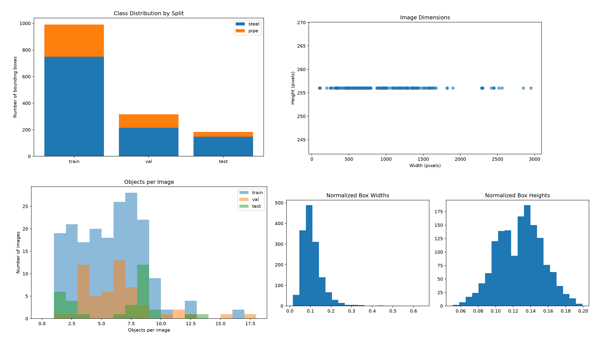
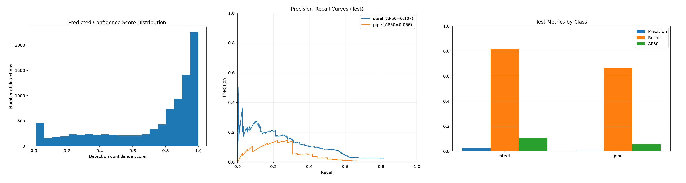
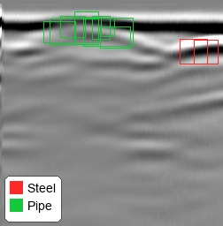

# PyGPR — Deep Learning for Ground Penetrating Radar Image Processing

An experimental computer vision project built with Python and PyTorch for detecting steel-related objects and pipes in Ground Penetrating Radar (GPR) images.

---

## Author

**Naeim Mousavi**

GitHub: [@nmousavi2020](https://github.com/nmousavi2020)

Copyright (c) 2026 N. Mousavi.

---

## Overview

PyGPR explores deep learning for subsurface imaging, infrastructure inspection, and potential anomaly analysis.

The workflow is:

```text
GPR Dataset
       ↓
Dataset Validation
       ↓
Annotation Analysis
       ↓
Custom CNN-Based Object Detector
       ↓
Model Training
       ↓
Model Evaluation
       ↓
Object Detection
       ↓
Prediction Visualization
       ↓
Evaluation Outputs
```

---

## Features

- Custom CNN-based object detector implemented in PyTorch
- No pretrained YOLO weights or Ultralytics detection/training pipeline
- Dataset validation and annotation analysis
- Model training and object detection evaluation
- Bounding-box visualization and non-maximum suppression (NMS)
- GPU acceleration when CUDA is available

---

## Project Structure

```text
PyGPR/
│
├── outputs/
│   ├── 1.data.png
│   ├── 2.evaluate.png
│   └── 3.prediction.jpg
│
├── diagnose_dataset.py
├── dataset.py
├── model.py
├── train.py
├── evaluate.py
├── predict.py
├── README.md
├── LICENSE
└── .gitignore
```

---

## Method

### 1. Dataset

The dataset is based on the P-GPR: A Ground Penetrating Radar Dataset for Pipeline Detection publication.

| Split | Images | Labels |
|---|---:|---:|
| Training | 188 | 188 |
| Validation | 54 | 54 |
| Test | 31 | 31 |
| Total | 273 | 273 |

### 2. Detection Classes

```text
0 — Steel
1 — Pipe
```

### 3. Annotation Format

Annotations use normalized bounding boxes:

```text
class_id x_center y_center width height
```

### 4. Model Architecture

A custom CNN-based object detector is implemented in PyTorch. The project does not use pretrained YOLO weights or the Ultralytics detection/training pipeline.

### 5. Model Training and Evaluation

Dataset validation and annotation analysis, model training, and object detection evaluation.

### 6. Prediction

Bounding-box visualization and non-maximum suppression (NMS). GPU acceleration when CUDA is available.

---

## Output

Prediction images and evaluation outputs are saved under the `outputs/` directory.

```text
outputs/
├── 1.data.png
├── 2.evaluate.png
└── 3.prediction.jpg
```

---

## Diagnostic Results

### Figure 1. Dataset Summary

Overview of the dataset and annotation statistics.

<p align="center">

</p>

### Figure 2. Model Evaluation

Initial evaluation results showing the current detection performance.

<p align="center">

</p>

### Figure 3. Prediction Example

Example detection output on a GPR image.

<p align="center">

</p>

---

## Dataset Citation

Yue, J., Qin, Y., Zhu, M., Ye, S., & Wang, Y. (2026). P-GPR: A Ground Penetrating Radar Dataset for Pipeline Detection. Proceedings of the 35th ACM International Conference on Information and Knowledge Management (CIKM '26), Rome, Italy. ACM.

Please consult the original publication and dataset license for applicable usage terms.

---

## Quick Start

Run commands from the project directory.

### 1. Validate the Dataset

```bash
python diagnose_dataset.py
```

### 2. Test the Dataset Loader and Model

```bash
python dataset.py
python model.py
```

### 3. Train the Model

```bash
python train.py
```

### 4. Evaluate the Detector

```bash
python evaluate.py
```

### 5. Run Predictions

```bash
python predict.py --source "dataset/test/images" --confidence 0.25
```

Prediction images and evaluation outputs are saved under `outputs/`.

Adjust script names or arguments if your local files use different names.

---

## Limitations

- The project is experimental.
- Initial evaluation results show the current detection performance.
- Dataset usage remains subject to the original publication and dataset license terms.

---

## Next Step

The project workflow is organized around dataset validation, model training, evaluation, and prediction.

```text
GPR Dataset
       ↓
Dataset Validation
       ↓
Annotation Analysis
       ↓
Model Training
       ↓
Model Evaluation
       ↓
Object Detection
       ↓
Prediction Visualization
       ↓
Diagnostic Outputs
```

---

## License

The project code is distributed under the MIT License.

The dataset is attributed to its original authors and remains subject to its own license and terms of use.

See the [LICENSE](LICENSE) file for details.

---
